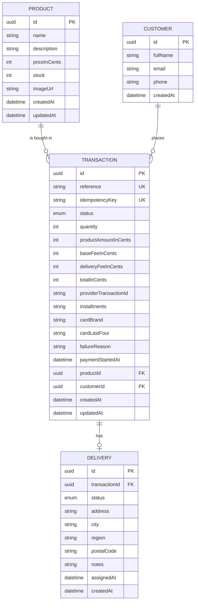

# Payment Gateway — Checkout Store Back-end

Back-end for a checkout store: a catalog API that lists tech-accessory products and their stock so customers
can browse before buying. This is the foundation of a 5-screen store flow:

1. **Product catalog** — browse all products with price and stock.
2. **Product details** — inspect a single product.
3. **Shopping cart** — add products to the cart.
4. **Checkout & payment** — pay through the payment provider.
5. **Order confirmation** — confirm and track delivery.

The catalog (`GET /products`, `GET /products/:id`) and the **checkout & payment** back-end are implemented:
purchases are created (`POST /transactions`), stock is reserved atomically, card payment is started
(`POST /transactions/:id/payment`) and the purchase state is read back (`GET /transactions/:id`). The cart,
order-confirmation screen and the front-end remain upcoming (see [Status & roadmap](#status--roadmap)). Money is
handled as integers in COP minor units (`*InCents`), never as floats, and card data never reaches this
service (see [Security notes](#security-notes)).

## Live deployment

- **Back-end**: https://paymentgateway-nest-test-production.up.railway.app
- **Swagger docs**: https://paymentgateway-nest-test-production.up.railway.app/docs
- **Front-end**: https://observant-cat-production-6bfd.up.railway.app

The live deployment runs against the payment provider **sandbox** and accepts **test cards only**:

| Card number             | Outcome  |
| ----------------------- | -------- |
| `4242 4242 4242 4242`   | approved |
| `4111 1111 1111 1111`   | declined |

## Tech stack

- **Back-end**: Node.js LTS, TypeScript (strict), NestJS
- **Database**: PostgreSQL via [Prisma](https://prisma.io) ORM (version 6.14 pinned)
- **Validation**: `class-validator`, `class-transformer`
- **Security**: `helmet`, scoped CORS, `@nestjs/throttler` rate limiting
- **API docs**: `@nestjs/swagger` (OpenAPI 3, Swagger UI at `/docs`)
- **Testing**: Jest (unit, colocated `*.spec.ts`) + Supertest (e2e in `back-end/test/`)
- **Monorepo layout**: `back-end/`, `front-end/` (upcoming), `docs/`, `specs/`

## Architecture

Hexagonal (ports & adapters) layout with three layers that only depend inward:

```text
back-end/
├── src/
│   ├── domain/                         # business core, no framework or infra imports
│   │   ├── entities/                   # Product, Transaction, Customer, Delivery
│   │   ├── ports/                      # ProductRepository, TransactionRepository,
│   │   │                               # PaymentGateway, Clock, ReferenceGenerator
│   │   ├── value-objects/              # FeesConfig (base/delivery fees, currency)
│   │   └── errors/                     # ProductNotFound, InsufficientStock, … , DataAccessError
│   ├── application/
│   │   ├── result/                     # Result type (ok/err, map, flatMap, match)
│   │   └── use-cases/                  # GetProducts, GetProductById, CreateTransaction,
│   │                                   # PayTransaction, GetTransaction, GetCheckoutConfig
│   ├── infrastructure/
│   │   ├── config/                     # env validation (fail fast)
│   │   ├── persistence/                # PrismaService, PrismaProductRepository,
│   │   │                               # PrismaTransactionRepository
│   │   ├── payments/                   # HTTP PaymentGateway adapter (provider host, secrets)
│   │   ├── http/                       # products/transactions/payments controllers, DTOs,
│   │   │                               # error filter/mapper, configureApp, configureSwagger
│   │   └── modules/                    # Nest modules, useFactory wiring, injection tokens
│   ├── app.module.ts
│   └── main.ts
├── prisma/
│   ├── schema.prisma
│   ├── migrations/                     # hand-edited CHECK constraints
│   └── seed.ts                         # idempotent upsert with fixed UUIDs
└── test/                               # e2e (Supertest) with an in-memory fake repository
```

- **Domain** is pure TypeScript: the `Product`, `Transaction`, `Customer` and `Delivery` entities, the errors
  and the ports (`ProductRepository`, `TransactionRepository`, `PaymentGateway`, `Clock`,
  `ReferenceGenerator`) have no framework or infrastructure imports.
- **Use cases are plain classes** wired in Nest modules with `useFactory` providers and an injection token
  for the port. They never touch Prisma or Nest; the payment gateway is a port implemented only in
  `infrastructure/payments`.
- **Controllers are driving adapters** in `infrastructure/http`: they parse input, call a use case and map the
  `Result` to an HTTP response.

### Result type and error flow

Use cases follow **Railway Oriented Programming**: they return a discriminated union `Result<Ok, Err>`
(`ok(value)` or `err(error)`) instead of throwing for business failures. Port methods throw; the Prisma adapter
wraps any failure in a `DataAccessError` keeping the original `cause`; use cases convert **only**
`DataAccessError` into `err(...)` and let any other error propagate.

Errors then flow to a single global filter:

1. The controller unwraps the `Result` (a failed result is thrown as the error).
2. `AllExceptionsFilter` catches everything, including framework errors and 404/405/429.
3. `error.mapper` maps the error to `{ statusCode, code, message }`.
4. `error-body` produces the final 5-key body with `path` and `timestamp`.
5. For server errors (5xx) the filter also logs the full failure (with its `cause` chain) on the server — the
   client only ever sees the generic body, never internals or stack traces.

## Prerequisites

- Node.js LTS and `npm`
- A local PostgreSQL server (recommended, validated) **or** Docker (optional path, not yet validated)
- `psql` (to run the CHECK constraint verification)

## Setup

### Local PostgreSQL (validated path)

1. Create the database (name it to match `DATABASE_URL`, e.g. `paymentgateway`):

   ```bash
   createdb paymentgateway
   ```

2. Copy the environment template and fill it in:

   ```bash
   cp .env.example .env
   ```

3. Install dependencies, generate the Prisma client, apply the migrations and seed:

   ```bash
   cd back-end
   npm ci
   npm run prisma:generate
   npm run prisma:migrate:deploy
   npm run prisma:seed
   ```

4. Start the API:

   ```bash
   npm run start:dev
   ```

5. Verify the endpoints and the docs:

   ```bash
   curl localhost:3000/products
   curl localhost:3000/products/77777777-7777-4777-8777-777777777777
   curl localhost:3000/payments/checkout-config
   open http://localhost:3000/docs
   ```

   The migration scripts read the root `.env` (they run with `dotenv-cli -e ../.env`). For the full
   checkout/payment walkthrough, see
   [`specs/002-transacciones-pagos/quickstart.md`](specs/002-transacciones-pagos/quickstart.md).

### Docker Compose (optional, not yet validated)

A `postgres` service is provided in the root `docker-compose.yml` (PostgreSQL 16 alpine, named volume,
healthcheck, credentials read from the same `.env`):

```bash
docker compose up -d postgres
```

Then follow the same steps 3–5 above. This path is **not yet validated** as a clean-start flow: it moves to
the deployment feature and is documented here only as an option.

## Environment variables

All names, taken from `.env.example` (empty values; fill them in your local `.env`):

| Variable                       | Used by                                            |
| ------------------------------ | -------------------------------------------------- |
| `DATABASE_URL`                 | App / Prisma                                        |
| `PORT`                         | App (HTTP port)                                     |
| `NODE_ENV`                     | App (`development`, `test`, `production`)           |
| `CORS_ORIGINS`                 | App (comma-separated allowed origins)               |
| `RATE_LIMIT_TTL`               | App (throttler time window, seconds)                |
| `RATE_LIMIT_MAX`               | App (throttler max requests per window)             |
| `UAT_SANDBOX_URL`              | Payment provider adapter (sandbox base URL)         |
| `pub_stagtest`                 | Checkout config (public key returned to the browser) |
| `prv_stagtest`                 | Payment provider adapter (private key, server-side) |
| `stagtest_events`              | Payment provider adapter (events checksum secret)   |
| `stagtest_integrity`           | Payment provider adapter (integrity secret)         |
| `BASE_FEE_IN_CENTS` *(optional)* | Fees config — default 300000 (shown as a comment) |
| `DELIVERY_FEE_IN_CENTS` *(optional)* | Fees config — default 900000 (shown as a comment) |
| `PAYMENT_TIMEOUT_MS` *(optional)* | Provider call timeout — default 10000           |
| `RESERVATION_TTL_SECONDS` *(optional)* | Stock reservation TTL — default 900        |
| `PAYMENT_CLAIM_LEASE_SECONDS` *(optional)* | Payment claim lease — default 120     |
| `TEST_DATABASE_URL`            | Integration suite only (DB name must end `_test`)   |
| `POSTGRES_USER`                | Docker Compose only                                 |
| `POSTGRES_PASSWORD`            | Docker Compose only                                 |
| `POSTGRES_DB`                  | Docker Compose only                                 |

`.env.example` keeps **every** value empty and writes any default as a comment next to the name (constitution
V). The optional fee/timer variables fall back to the defaults above when empty. `TEST_DATABASE_URL` is used
**only** by the integration suite and never by the app. Startup **fails fast** if a required variable is
missing or invalid (`src/infrastructure/config/env.validation.ts`).

## npm scripts

Run from `back-end/`:

| Script                        | Description                                        |
| ----------------------------- | -------------------------------------------------- |
| `npm run start:dev`           | Start the API in watch mode                        |
| `npm run build`               | Type-check and compile (`nest build`)              |
| `npm run lint`                | `oxlint` (type-aware) over `src/` and `test/`      |
| `npm test`                    | Unit tests (Jest)                                  |
| `npm run test:cov`            | Unit tests with coverage report                    |
| `npm run test:e2e`            | End-to-end tests (Supertest, `--config test/jest-e2e.json`) |
| `npm run test:int`            | Integration suite vs. real PostgreSQL (`TEST_DATABASE_URL`, DB name must end `_test`) |
| `npm run prisma:migrate:deploy` | Apply Prisma migrations (reads root `.env`)      |
| `npm run prisma:migrate:dev`  | Create/apply migrations during development         |
| `npm run prisma:migrate:test` | Apply migrations to the test database only (`TEST_DATABASE_URL`) |
| `npm run prisma:generate`     | Generate the Prisma client                         |
| `npm run prisma:seed`         | Seed the database (idempotent `upsert`)            |
| `npm run prisma:studio`       | Open Prisma Studio                                 |

## API reference

All endpoints return JSON. Errors always use the same body shape and never leak internal details.

### `GET /products`

Returns the full product catalog (products with `stock` 0 are still listed). 200 example (abridged):

```json
[
  {
    "id": "77777777-7777-4777-8777-777777777777",
    "name": "Cable Organizer",
    "description": "Cable management set",
    "priceInCents": 1500000,
    "stock": 40,
    "imageUrl": "/images/products/cable-organizer.webp"
  },
  {
    "id": "99999999-9999-4999-8999-999999999999",
    "name": "External SSD",
    "description": "1TB portable SSD",
    "priceInCents": 35000000,
    "stock": 7,
    "imageUrl": "/images/products/external-ssd.webp"
  }
]
```

### `GET /products/:id`

Returns a single product (`id` is a UUID). 200 example:

```json
{
  "id": "77777777-7777-4777-8777-777777777777",
  "name": "Cable Organizer",
  "description": "Cable management set",
  "priceInCents": 1500000,
  "stock": 40,
  "imageUrl": "/images/products/cable-organizer.webp"
}
```

### `GET /payments/checkout-config`

Public, non-secret configuration for the browser to render the two contracts and tokenize the card. The
`publicKey` is public by design; secrets stay server-side. 200 example:

```json
{
  "publicKey": "pub_****",
  "baseUrl": "https://<sandbox-host>/v1",
  "currency": "COP",
  "contracts": {
    "terms": "https://<host>/.../end-user-policy",
    "personalData": "https://<host>/.../personal-data"
  },
  "installments": { "default": 1, "max": 36 }
}
```

Returns `503 PAYMENT_PROVIDER_UNAVAILABLE` when the merchant info cannot be read.

### `POST /transactions`

Creates a `PENDING` purchase, reserves stock and returns the server-computed amount breakdown. Requires the
header `Idempotency-Key: <16–64 chars of letters, digits, dash or underscore>`.

Request:

```json
{
  "productId": "11111111-1111-4111-8111-111111111111",
  "quantity": 1,
  "customer": { "fullName": "Test Buyer", "email": "buyer@example.com", "phone": "+57 300 000 0000" },
  "delivery": { "address": "Calle 1 #2-3", "city": "Bogotá", "region": "Cundinamarca", "notes": "Ring twice" }
}
```

`201 Created` (first time):

```json
{
  "id": "f0e1...",
  "reference": "TXN-7K3F9Q2M8XJA4B6C",
  "status": "PENDING",
  "quantity": 1,
  "amounts": {
    "productAmountInCents": 1500000,
    "baseFeeInCents": 300000,
    "deliveryFeeInCents": 900000,
    "totalInCents": 2700000
  }
}
```

`200 OK` — replay: the same `Idempotency-Key` (and same product, quantity and customer email) returns the
previously created purchase (same `id` and `reference`), never a new one. Amounts are always recomputed by the
server; client-sent amounts are rejected with `400`.

| Status | code | When |
|--------|------|------|
| 400 | `BAD_REQUEST` | Malformed body, unknown/extra fields, quantity above 10 (or below 1), missing/malformed `Idempotency-Key`. |
| 404 | `PRODUCT_NOT_FOUND` | The product does not exist. |
| 409 | `INSUFFICIENT_STOCK` | Requested quantity exceeds available stock. |
| 409 | `IDEMPOTENCY_KEY_REUSED` | The key was reused with a different product, quantity or customer email. |

### `POST /transactions/:id/payment`

Starts the card payment for a pending purchase. `cardToken` is a single-use token produced by the browser
(card data never reaches this service); `installments` defaults to 1; `acceptedContracts` must be `true`.

Request:

```json
{ "cardToken": "tok_test_...", "installments": 1, "acceptedContracts": true }
```

`202 Accepted` — the payment is in progress (the purchase is `PENDING` and the provider transaction is created
once, or the claim is already active); the current transaction view is returned and no second charge occurs.
`200 OK` — only when the provider answers with an already final status at creation.

| Status | code | When |
|--------|------|------|
| 400 | `BAD_REQUEST` | Malformed body / missing `cardToken`. |
| 404 | `TRANSACTION_NOT_FOUND` | Unknown purchase id. |
| 409 | `TRANSACTION_NOT_PAYABLE` | The purchase is not `PENDING` (already approved, declined, voided or in error). |
| 422 | `CONTRACTS_NOT_ACCEPTED` | `acceptedContracts` is not `true`. |
| 422 | `INVALID_PAYMENT_TOKEN` | The provider definitively rejected the token; the claim is cleared so the shopper can retry. |
| 502 | `PAYMENT_PROVIDER_REJECTED` | Any other provider 4xx; generic message. |
| 503 | `PAYMENT_PROVIDER_UNAVAILABLE` | Provider timed out, network error or 5xx; the claim is kept (reconcile by reference on retry). |

### `GET /transactions/:id`

Source of truth for the front-end. While `PENDING`, the service reads the provider and finalizes
idempotently; the response always reflects the current state. 200 example:

```json
{
  "id": "f0e1...",
  "reference": "TXN-7K3F9Q2M8XJA4B6C",
  "status": "APPROVED",
  "quantity": 1,
  "amounts": { "productAmountInCents": 1500000, "baseFeeInCents": 300000, "deliveryFeeInCents": 900000, "totalInCents": 2700000 },
  "card": { "brand": "VISA", "lastFour": "4242", "installments": 1 },
  "product": { "id": "11111111-1111-4111-8111-111111111111", "name": "Cable Organizer", "quantity": 1 },
  "delivery": { "status": "ASSIGNED", "address": "Calle 1 #2-3", "city": "Bogotá", "region": "Cundinamarca" },
  "failureReason": null
}
```

Returns `404 TRANSACTION_NOT_FOUND` for an unknown purchase. On approval the delivery becomes `ASSIGNED`; on
decline/void/error the reserved stock is released.

> There is also an **optional** `POST /webhooks/payment-events` endpoint (provider events; verifies the
> checksum and reconciles through the same finalization). It is not enabled in the current configuration — see
> [Known limitations](#known-limitations).

### Purchase flow

```mermaid
stateDiagram-v2
    [*] --> PENDING: POST /transactions (stock reserved)
    PENDING --> APPROVED: pay (provider approves; delivery ASSIGNED)
    PENDING --> DECLINED: pay (provider declines; stock released)
    PENDING --> VOIDED: expired reservation / void (stock released)
    PENDING --> ERROR: pay error (stock released)
    APPROVED --> [*]
    DECLINED --> [*]
    VOIDED --> [*]
    ERROR --> [*]
```



A purchase is created `PENDING` with its stock reserved. Paying it once leads to a final state; every final
state except `APPROVED` releases the reserved stock, and only `APPROVED` assigns the delivery. A purchase
whose payment was never started and that is older than `RESERVATION_TTL_SECONDS` is released lazily on read
as `VOIDED` with `failureReason = "RESERVATION_EXPIRED"`.

### Error body

Every error, from framework errors to 429s, uses this 5-key shape:

| Field       | Type   | Description                              |
| ----------- | ------ | ---------------------------------------- |
| `statusCode`| number | HTTP status                              |
| `code`      | string | Machine-readable code (`PRODUCT_NOT_FOUND`, `BAD_REQUEST`, `TOO_MANY_REQUESTS`, `INTERNAL_ERROR`, …) |
| `message`   | string | Human-readable message                   |
| `path`      | string | Request path                             |
| `timestamp` | string | ISO 8601 timestamp                      |

404 example (unknown but well-formed UUID):

```json
{
  "statusCode": 404,
  "code": "PRODUCT_NOT_FOUND",
  "message": "Product with id \"00000000-0000-4000-8000-000000000000\" was not found",
  "path": "/products/00000000-0000-4000-8000-000000000000",
  "timestamp": "2026-10-09T04:38:33.811Z"
}
```

400 example (malformed id):

```json
{
  "statusCode": 400,
  "code": "BAD_REQUEST",
  "message": "Validation failed (uuid is expected)",
  "path": "/products/999999",
  "timestamp": "2026-10-09T04:38:33.829Z"
}
```

A repository failure always produces a generic 500 body (`code: "INTERNAL_ERROR"`,
`message: "Internal server error"`) regardless of the underlying cause; the real failure — including its
`cause` chain — is logged on the server only.

## Payment provider sandbox

The provider exposes a sandbox. The browser tokenizes the card with the **public key** returned by
`GET /payments/checkout-config`, then sends the resulting single-use token to `POST /transactions/:id/payment`.
Sandbox test cards:

| Card number             | Outcome  |
| ----------------------- | -------- |
| `4242 4242 4242 4242`   | approved |
| `4111 1111 1111 1111`   | declined |
| any other number        | error    |

A manual, end-to-end walkthrough (including the optional spike script `back-end/scripts/sandbox-spike.sh`)
lives in [`specs/002-transacciones-pagos/quickstart.md`](specs/002-transacciones-pagos/quickstart.md).
Automated tests never call the real sandbox.

## Swagger

Interactive API documentation is available while the API runs:

- UI: http://localhost:3000/docs
- OpenAPI JSON: http://localhost:3000/docs-json

All endpoints are documented under the `products`, `transactions` and `payments` tags, including their
200/201/202/400/404/409/422/502/503/500 responses and the shared `ErrorResponseDto` schema.

## Data model

All ids are UUIDs. Money is stored as integers in COP minor units (fields end in `InCents`). The schema
defines the four entities, and domain logic is implemented for all of them.



The payment-fields migration adds `installments`, `cardBrand`, `cardLastFour` and `paymentStartedAt`. Only
non-sensitive card metadata is stored: the **brand** and the **last four digits**, never the PAN, CVV or expiry.
`paymentStartedAt` is the re-claimable payment lease used to start a provider charge at most once per purchase.

Enums: `TransactionStatus` → `PENDING | APPROVED | DECLINED | VOIDED | ERROR`; `DeliveryStatus` →
`PENDING | ASSIGNED`. `Transaction.reference` and `Transaction.idempotencyKey` are unique; `Delivery` has one
transaction per delivery.

## CHECK constraints

`schema.prisma` cannot express CHECK constraints, so they are added by hand in a SQL migration
(`prisma migrate dev --create-only`). Key ones: `products.stock >= 0`, `products.price_in_cents > 0`,
`transactions.quantity > 0`, all `transactions.*_in_cents >= 0`, and
`transactions.total_in_cents = product_amount_in_cents + base_fee_in_cents + delivery_fee_in_cents`.

You can verify that a negative stock is rejected at the database level:

```bash
psql "$DATABASE_URL" -c "INSERT INTO products
  (id, name, description, price_in_cents, stock, image_url, created_at, updated_at)
  VALUES ('aaaaaaaa-aaaa-4aaa-8aaa-aaaaaaaaaaaa', 'Broken product', 'Should be rejected', 1000, -1,
          '/images/products/broken.webp', now(), now());"
```

Expected failure:

```text
ERROR:  new row for relation "products" violates check constraint "products_stock_non_negative"
```

## Testing and coverage

- **Unit tests** (`*.spec.ts` colocated in `src/`): Result helpers, every use case with the in-memory fake
  repositories and fake gateway, the card-payment adapter with a mocked `fetch`, error mapper and filter, and
  the Prisma repository adapters with a mocked `PrismaService`.
- **E2E tests** (`back-end/test/*.e2e-spec.ts`): product list & detail, transaction creation (amounts,
  validation, idempotency replay and `409` reuse, overselling race), payment (202/200/422/503/409), status,
  checkout config, error bodies, security headers, CORS, rate limiting and Swagger — booted through the same
  `configureApp` as production. They use the fake gateway and **never** call the real sandbox.
- **Integration tests** (`back-end/test/integration/*.int-spec.ts`, `npm run test:int`): the real
  `PrismaTransactionRepository` against PostgreSQL, covering the CHECK constraints and the
  reserve/claim/finalize/expire races. They need `TEST_DATABASE_URL` (database name must end with `_test`) and
  are excluded from `test:cov` and `test:e2e`.

Real results on the current state:

```text
Unit / coverage:  54 suites, 495 tests
  All files        Statements 96.38 %, Branches 90.73 %, Functions 100 %, Lines 96.19 %
E2E:              12 suites, 49 tests
Integration:      1 suite, 21 tests (real PostgreSQL; not part of the coverage run)
```

The global coverage threshold is **≥ 80 %** for statements, branches, functions and lines
(`coverageThreshold` in `back-end/jest.config.ts`). Measured roots and exclusions also come from
`jest.config.ts`: coverage is collected from `src/**` and `libs/**`, `apps/**`, excluding `src/main.ts`,
`src/**/*.module.ts`, `src/**/*.dto.ts`, `src/**/*.spec.ts`, `src/generated/**` and `src/testing/**` (the
in-memory fake used by e2e tests).

## Security notes

- **Helmet**: global security headers (CSP, `X-Content-Type-Options`, `X-Frame-Options`, HSTS, …); the
  `x-powered-by` header is removed.
- **Scoped CSP for Swagger**: Swagger UI needs inline scripts, so the CSP is relaxed **only** under `/docs`
  (`script-src 'self' 'unsafe-inline' 'unsafe-eval'`); every other route keeps the strict Helmet policy.
- **CORS**: only the origins in `CORS_ORIGINS` (comma-separated) are reflected; other origins get no
  `Access-Control-Allow-Origin`.
- **Rate limiting**: `@nestjs/throttler` limited per `RATE_LIMIT_TTL`/`RATE_LIMIT_MAX`; over the limit,
  clients get `429` with the standard 5-key body and a `Retry-After` header.
- **Validation**: `ValidationPipe` with `whitelist`, `forbidNonWhitelisted` and `transform`; malformed UUIDs
  are rejected with `400`.
- **No card data**: card number and CVC never reach this service — the browser tokenizes the card with the
  provider's public key and only sends the single-use token. The data model stores no PAN, CVV or expiry;
  `Transaction` keeps only non-sensitive metadata (`installments`, `cardBrand`, `cardLastFour`,
  `providerTransactionId`, `failureReason`).
- **Provider secrets stay server-side**: the private/integrity/events secrets are read from environment
  variables and used **only** inside the `infrastructure/payments` gateway adapter; they never appear in
  responses, logs or the public checkout config.
- **Safe 5xx**: users always receive a generic body; details (including the `cause` chain) are logged on the
  server only.

## Spec-driven workflow

This repository follows a spec-driven workflow: the feature is specified up front, broken into tasks, and
implemented and verified agent-in-command with **Spec Kit** artifacts and the **opencode** CLI. Tests are
written first (red-green), and each phase is committed by the developer.

The specs for the two back-end features live in:

- [`specs/001-back-end-base/`](specs/001-back-end-base/) — product catalog, security baseline, error bodies.
- [`specs/002-transacciones-pagos/`](specs/002-transacciones-pagos/) — transactions, card payment,
  idempotency, stock reservation, checkout config.

Each folder carries `spec.md`, `plan.md`, `data-model.md` (where applicable), `contracts/`, `quickstart.md`
and `tasks.md`.

## Known limitations

- **Pending payment keeps its stock reserved**: a purchase whose payment was started but stays `PENDING`
  keeps its stock reserved until the provider resolves it; only reservations that were never paid expire
  (lazily) after `RESERVATION_TTL_SECONDS`.
- **The webhook is not enabled**: `POST /webhooks/payment-events` is optional and disabled in the current
  configuration, so finalization relies on the read path (`GET /transactions/:id`) reconciling with the
  provider.
- **Automated tests never call the real sandbox**: the unit and e2e suites use fakes/mocked `fetch`; the
  integration suite exercises only the real database. The sandbox is validated manually
  (`back-end/scripts/sandbox-spike.sh` and the quickstart).

## Status & roadmap

**Done**: product catalog (`GET /products`, `GET /products/:id`) and the checkout & payment back-end
(`GET /payments/checkout-config`, `POST /transactions`, `POST /transactions/:id/payment`,
`GET /transactions/:id`), idempotent creation with replay/`409` semantics, atomic stock reservation,
re-claimable payment lease with reconcile-by-reference, consistent error bodies, security baseline (Helmet,
CORS, rate limiting, validation, safe errors, no card data), Swagger at `/docs`, database migrations with
CHECK constraints, idempotent seed, unit + e2e + integration test suites, and this documentation.

**Upcoming**:

- Front-end store screens (catalog, product detail, cart, checkout).
- Order confirmation and delivery tracking screens.
- Optional payment-events webhook enablement.
- Deployment (including the docker compose clean-start validation).

**Card data is never processed or stored in this repository.**